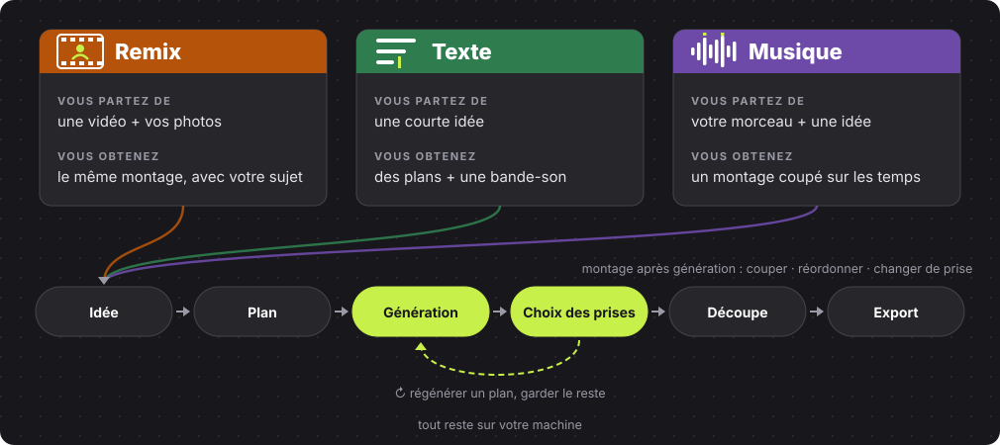

<p align="center"><b>Un studio vidéo IA local pour des montages que vous continuez à diriger.</b><br>Remixez une référence, partez d'une idée ou construisez autour de votre musique.</p>

<p align="center"><a href="README.md">English</a> · <a href="#exemples">Exemples</a> · <a href="#installation-windows">Installation</a> · <a href="LICENSES.md">Licences</a></p>

<p align="center"><b>Bêta.</b> La finition (effets, titres, motion graphics, sound design) est expérimentale et désactivée par défaut.</p>

<p align="center">Construit avec ComfyUI pour le <a href="https://comfy.org/open-source-higgsfield">concours Comfy Open Source Higgsfield</a>. Modèles open weights, exécutés sur votre machine.</p>

<p align="center"><b>Fait pour les vidéos courtes :</b> clips viraux et storytelling court.<br>Inspiré de Katana, Genjutsu et Cinema Studio de Higgsfield.</p>

## Démo

<table align="center">
<tr><th>Démo réseaux sociaux · 1 min 51</th><th>Présentation · 1 min 47</th></tr>
<tr>
<td align="center"><a href="docs/media/hyperkut-demo-official.mp4"></a></td>
<td align="center"><a href="docs/media/hyperkut-demo-readme.mp4"></a></td>
</tr>
</table>

<p align="center">Aperçus muets : cliquez pour voir la vidéo complète avec le son.<br>Toutes les personnes visibles sont générées par IA par l'auteur.</p>

## Ce que fait HyperKut

<p align="center"></p>

- **Corrigez un plan, gardez le reste.** Modifiez le prompt d'un plan et régénérez seulement celui-là.
- **Montez après la génération.** Coupez, réordonnez et changez de prise sur une timeline.
- **Tout reste local.** Vos projets, vos modèles, du code MIT ouvert.

<table align="center">
<tr><th>Lancer un projet</th><th>Diriger chaque plan</th><th>Finaliser le montage</th></tr>
<tr>
<td align="center"><a href="docs/media/studio-home.jpg"></a></td>
<td align="center"><a href="docs/media/studio-project.jpg"></a></td>
<td align="center"><a href="docs/media/studio-finishing.jpg"></a></td>
</tr>
</table>

## Exemples

<p align="center">De vrais exports HyperKut. Cliquez sur un aperçu pour voir la vidéo avec le son.</p>

<table align="center">
<tr><th>Mode · Remix</th><th>Lookbook · Remix</th><th>Mode · Musique</th><th>Sneaker · Musique</th></tr>
<tr>
<td align="center"><a href="docs/media/demos/hyperkut_26c4e181fe36.mp4"></a></td>
<td align="center"><a href="docs/media/demos/hyperkut_4eaec061ddbd.mp4"></a></td>
<td align="center"><a href="docs/media/demos/hyperkut_ac3723c049d9.mp4"></a></td>
<td align="center"><a href="docs/media/demos/hyperkut_f54b09f850b2.mp4"></a></td>
</tr>
</table>

<table align="center">
<tr><th>Produit · Texte</th><th>Personnage · Texte</th><th>Casque · Texte</th></tr>
<tr>
<td align="center"><a href="docs/media/demos/hyperkut_9e8e85878a3c.mp4"></a></td>
<td align="center"><a href="docs/media/demos/hyperkut_e721126225dd.mp4"></a></td>
<td align="center"><a href="docs/media/demos/hyperkut_c9cdc7be3b8b.mp4"></a></td>
</tr>
</table>

<p align="center">La vidéo de référence du Remix mode appartient à <a href="https://higgsfield.ai/@silver.muse">silver.muse</a>. Merci pour l'inspiration.</p>

## Comment ça marche

<p align="center"></p>

<p align="center">Graphe simplifié ; les workflows API ComfyUI de chaque mode sont dans <a href="workflows"><code>workflows/</code></a>.<br>Les nodes viennent de <a href="https://github.com/MajoorWaldi/ComfyUI-Majoor-VideoTools">Majoor VideoTools</a>.</p>

**Comment les serveurs communiquent.** Le serveur remplit un workflow et l'envoie via le Comfy SDK officiel. `comfy-api-proxy` sert l'API Comfy en local, devant ComfyUI. La progression et les aperçus remontent jusqu'au navigateur ; ComfyUI et le Studio partagent le dossier de sortie.

<p align="center"></p>

## Par rapport à Katana et Genjutsu

| | HyperKut | Higgsfield Katana | Higgsfield Genjutsu |
|---|---|---|---|
| Idée | Créer et retravailler un montage multi-plans | Recréer un montage de référence avec vos éléments, via Claude | Transformer une vidéo : transfert de mouvement ou remplacement d'objet |
| Exécution | Votre PC, ComfyUI local | Cloud Higgsfield | Cloud Higgsfield |
| Vous dirigez | Prompt par plan, prises, timeline | Instructions dans Claude | Vidéo source et réglages |
| Code | Ouvert, MIT | Géré par le fournisseur | Géré par le fournisseur |

HyperKut ne reproduit pas exactement les montages Katana et n'égale pas la préservation ciblée de Genjutsu. Sources : [Katana](https://higgsfield.ai/blog/higgsfield-katana), [Genjutsu](https://higgsfield.ai/creator-hub/help-center/tools/how-do-i-use-genjutsu), consultées le 29 octobre 2026.

## Installation Windows

**Il faut :** un GPU NVIDIA, [ComfyUI](https://github.com/Comfy-Org/ComfyUI), Python 3.10+, Node.js 22+ et FFmpeg dans le PATH.

1. Dans `ComfyUI/custom_nodes`, installez [Majoor VideoTools](https://github.com/MajoorWaldi/ComfyUI-Majoor-VideoTools) et `comfyui_controlnet_aux` avec le Python de ComfyUI.
2. Téléchargez les modèles de [l'inventaire](https://github.com/MajoorWaldi/ComfyUI-Majoor-VideoTools/blob/main/docs/models-and-downloads.md).
3. Clonez ce dépôt dans le dossier VideoTools, sous le nom `ComfyUI-Majoor-VideoTools/HyperKut Studio`.
4. Dans PowerShell, depuis `HyperKut Studio` :

```powershell
python -m venv .venv
.\.venv\Scripts\python.exe -m pip install -r requirements.txt
Push-Location frontend; npm ci; npm run build; Pop-Location
```

5. Lancez ComfyUI, puis `.\scripts\run_studio.ps1`, et ouvrez **http://127.0.0.1:8090/**.

Finition facultative, ports personnalisés et détails : [installation complète](docs/installation.md) · [guide d'utilisation](docs/usage.md) · [dépendances](docs/dependency-scopes.md).

## Licence

Code : **MIT**. Les modèles, dépendances et médias de démo gardent leurs propres conditions : voir [LICENSES.md](LICENSES.md) et les [mentions tierces](THIRD_PARTY_NOTICES.md). [Limites connues](docs/known-issues-and-roadmap.md) · [Roadmap](ROADMAP.md).

HyperKut est indépendant de Higgsfield.
