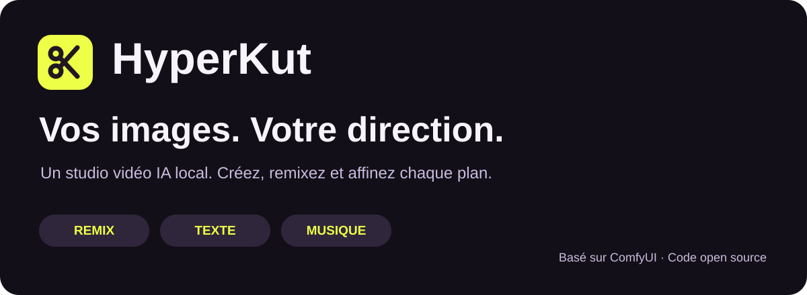
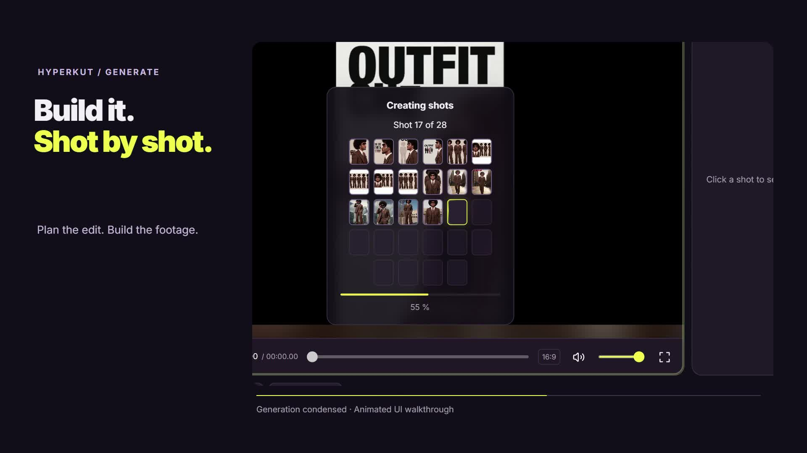
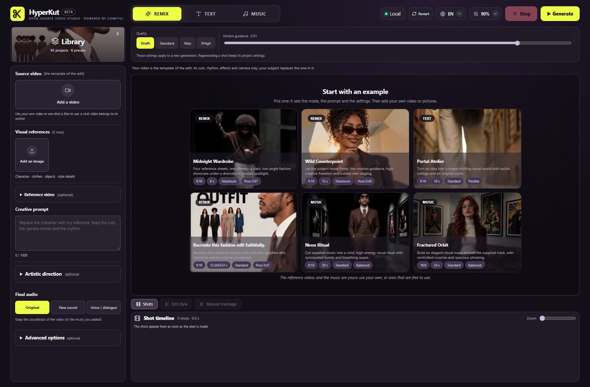
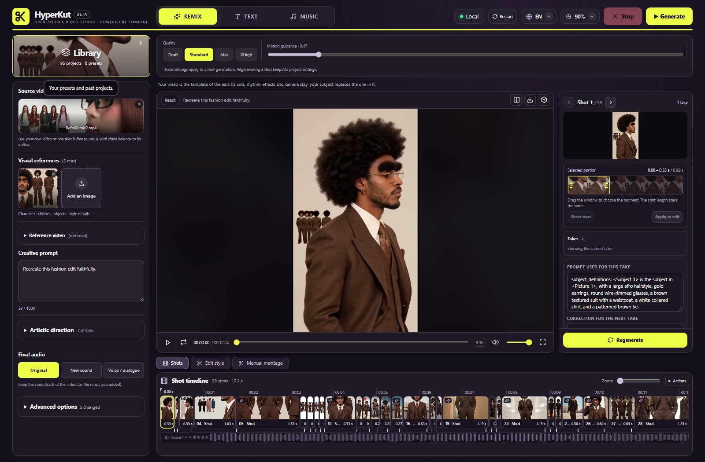
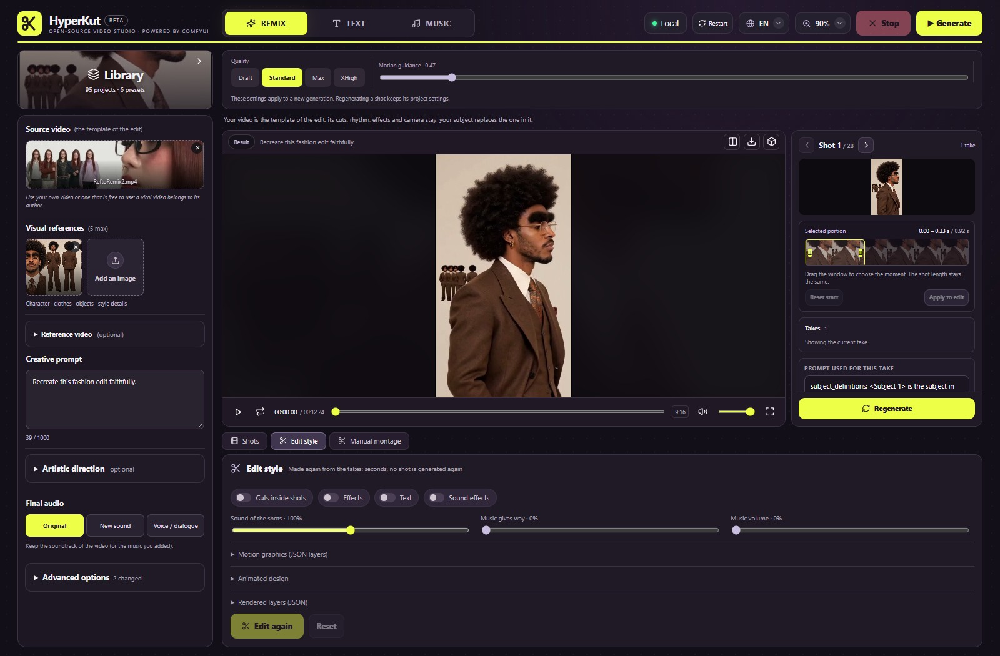
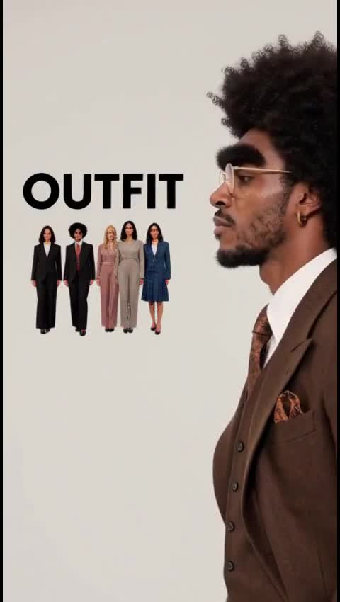
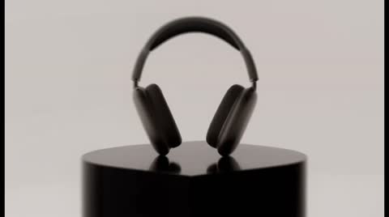
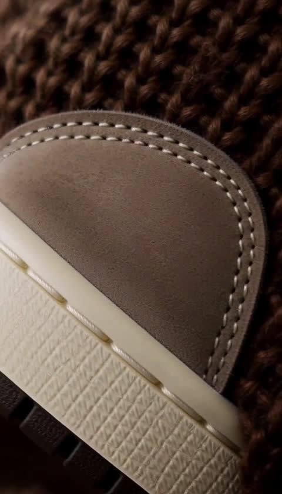

<p align="center"><b>Un studio vidéo IA local pour créer, remixer et affiner chaque plan.</b></p>

<p align="center"><a href="README.md">English</a> · <a href="#voir-les-résultats">Démos</a> · <a href="#installation-windows">Installation</a> · <a href="LICENSES.md">Licences</a></p>

> **BÊTA — Tout le Studio HyperKut est actuellement en bêta.** Les fonctionnalités et workflows continuent d’évoluer. **La finition est expérimentale :** coupes internes, effets visuels, textes/titres, motion graphics, animations graphiques, sound design et bruitages. Ces réglages facultatifs sont désactivés par défaut ; vérifiez leur résultat avant export.

## Démo officielle

<a href="docs/media/hyperkut-demo-official.mp4"></a>

**1 min 51 · 9:16 · avec son.** [Lire ou télécharger la démo officielle](docs/media/hyperkut-demo-official.mp4). Présentation choisie par l'auteur du projet.

## Démo README


[](docs/media/hyperkut-demo-readme.mp4)

**1 min 10 · 16:9 · narration anglaise · avec son.** [Lire ou télécharger](docs/media/hyperkut-demo-readme.mp4). Cette présentation paysage réunit une capture réelle du Studio, une démonstration animée à partir de ses composants et un véritable résultat enregistré. La régénération est illustrée : aucune nouvelle prise calculée n'est revendiquée. [Origine de la démo et outils employés](docs/demo-production.md).

Projet préparé pour le [concours Comfy Open Source Higgsfield](https://comfy.org/open-source-higgsfield). 

## Dans l'application réelle

| 1. Préparer son idée | 2. Diriger chaque plan | 3. Finaliser le montage |
|:---:|:---:|:---:|
| [](docs/media/studio-home.jpg) | [](docs/media/studio-project.jpg) | [](docs/media/studio-finishing.jpg) |
| Choisir un mode et ses médias. | Projet réel de 28 plans, prises et sélection du passage. | Finition expérimentale : coupes internes, effets, textes, animations et son. |

Captures de l'interface réelle du 29 octobre 2026. Aucune génération, régénération ni export n'a été lancé pour les obtenir. Le montage de 28 plans est un projet enregistré, pas une génération effectuée pendant cette mise à jour documentaire.

## HyperKut, ça fait quoi ?

**Donnez un point de départ. Obtenez un montage. Corrigez les plans qui en ont besoin.**

| Vous avez… | Mode | Ce que le studio vous aide à faire |
|---|---|---|
| Une vidéo et les photos d'un personnage ou produit | **Remix** | Réinterpréter son montage à partir de sa structure et de son rythme. |
| Une idée, avec ou sans images | **Texte** | Construire un découpage, générer les plans et créer une musique. |
| Une musique et une idée | **Musique** | Monter en tenant compte des pulsations et accents mesurés. |

**Idée → découpage → génération des plans → choix des prises → ajustements → export.**

Modifiez le prompt d'un plan, régénérez-le, gardez une autre prise ou choisissez un autre passage. L'éditeur de montage permet aussi de couper, réordonner et ajuster les durées. Les outils de finition — coupes internes, effets visuels, textes/titres, motion graphics, animations graphiques, sound design et bruitages — sont **expérimentaux**, facultatifs et **désactivés par défaut**.

## Ce qui fait son intérêt

L'apport d'HyperKut, c'est **le travail de montage local autour de la génération** :

- **Un projet complet** : intention, plans, musique et finition restent réunis.
- **Les bonnes prises sont conservées** : corriger un plan ne demande pas de régénérer tous les autres.
- **Montage et génération sont séparés** : ajuster les passages, les prises et la finition ne relance pas automatiquement le modèle vidéo. Le rendu local consomme toujours du calcul.
- **Le rythme se dirige** : l'analyse musicale guide les coupes en laissant de la place aux actions continues et aux respirations.
- **Le fonctionnement est adaptable** : code applicatif MIT, graphes ComfyUI, prompts et fichiers de projet locaux.

Ce sont des choix de conception, pas une promesse de supériorité ni une invention de toutes ces techniques.

## Voir les résultats

Cliquez sur une image pour ouvrir la vidéo. Pour les lire avec des contrôles et une option de boucle, ouvrez la [galerie locale](docs/demo-gallery.html) dans un navigateur. Les lecteurs vidéo intégrés ne fonctionnent pas sur tous les hébergeurs de Markdown.

| Mode / personnage | Produit | Musique / produit |
|:---:|:---:|:---:|
| [](docs/media/demos/hyperkut_26c4e181fe36.mp4) | [](docs/media/demos/hyperkut_c9cdc7be3b8b.mp4) | [](docs/media/demos/hyperkut_f54b09f850b2.mp4) |

[Tous les exemples et leurs fichiers](docs/demo-media.md). Les sept exports `hyperkut_…` sont séparés du clip fourni `outfit`. **Médias préparés pour validation privée : leurs droits de publication restent à vérifier séparément. La licence MIT du code ne couvre pas ces vidéos ni leurs bandes-son.**

## Crédits et remerciements

La vidéo de mode originale utilisée comme **référence Remix** dans notre exemple mode et la démonstration du Studio appartient à **[silver.muse](https://higgsfield.ai/@silver.muse)**, selon l'identification fournie par l'auteur du projet. Merci à silver.muse pour cette création originale et l'inspiration de cette démonstration Remix.

HyperKut a généré la réinterprétation présentée avec notre personnage de référence ; il n'a pas créé la vidéo source originale. Ce crédit ne constitue pas une autorisation de redistribution ni un soutien officiel de la créatrice ou du créateur.

## Par rapport à Katana et Genjutsu

| | HyperKut | Higgsfield Katana | Higgsfield Genjutsu |
|---|---|---|---|
| Objectif | Créer et retravailler un montage dans un studio local | Recréer un montage de référence ou un preset avec ses propres éléments, via Claude et Higgsfield MCP | Transformer une vidéo par transfert de mouvement ou remplacement ciblé |
| Génération | ComfyUI et modèles locaux | Services hébergés Higgsfield | Services hébergés Higgsfield |
| Interaction principale | Projets visuels, prompts par plan, prises et timeline | Référence, preset et instructions dans Claude | Vidéo source, références et réglages de transformation |
| Adaptation du fonctionnement | Code applicatif, graphes, prompts et finition | Implémentation gérée par le fournisseur | Implémentation gérée par le fournisseur |

HyperKut ne garantit pas la préservation ciblée annoncée par Genjutsu ni une copie exacte des montages Katana. Identité, mouvements, narration et cohérence musicale se valident à l'écoute et à l'image. Doublage complet, sous-titres issus de la parole et sélection sémantique de meilleurs passages ne constituent pas des fonctions intégrées validées.

Sources consultées le 29 octobre 2026 : [présentation de Katana](https://higgsfield.ai/blog/higgsfield-katana), [guide Genjutsu](https://higgsfield.ai/creator-hub/help-center/tools/how-do-i-use-genjutsu). HyperKut est indépendant de Higgsfield.

## Comment ça fonctionne

```text
Studio React — idée, références, plans, prises et timeline
       |
Serveur FastAPI — projets et exécution par étapes
       |
SDK officiel Comfy → comfy-api-proxy → ComfyUI local
       |                                 |
       |                     Gemma / H3 / YuE2 + options
       |                                 |
       +--------- prises conservées et plan de montage
                                         |
                       Assemblage VideoTools / FFmpeg
                       + graphismes HyperFrames demandés
                       + banque de bruitages Tone facultative
                                         |
                                   vidéo finale
```

La chaîne sépare planification, génération de chaque plan et montage. Studio et ComfyUI partagent actuellement le disque des médias ; changer une URL SDK ne suffit pas à valider un déploiement distant.

**Cas documenté :** [recette Remix mode et étapes de vérification](docs/examples/fashion-remix.md). Seed, réglages et empreintes des inputs sont conservés. La vidéo source n'est pas redistribuée : ce cas n'est donc pas encore un exemple public reproductible en une commande. [Configuration mesurée et portée des vérifications](docs/validation-summary.md).

## Installation Windows

**Préparer le moteur.** Installez un [ComfyUI récent](https://github.com/Comfy-Org/ComfyUI), [Majoor VideoTools](https://github.com/MajoorWaldi/ComfyUI-Majoor-VideoTools) et `comfyui_controlnet_aux`. Installez les dépendances des nodes dans **le Python de ComfyUI**. Téléchargez les modèles selon [l'inventaire](https://github.com/MajoorWaldi/ComfyUI-Majoor-VideoTools/blob/main/docs/models-and-downloads.md), sous leurs conditions respectives.

Le code du Studio doit être placé dans le dossier VideoTools :

```text
ComfyUI/custom_nodes/ComfyUI-Majoor-VideoTools/
├── core/  nodes/  scripts/
└── HyperKut Studio/
    ├── backend/  frontend/  workflows/
    └── README.md
```

Les sources du Studio sont distribuées séparément dans [HyperKut-Studio](https://github.com/MajoorWaldi/HyperKut-Studio). Le pack VideoTools correspondant reste nécessaire ; utilisez une version contenant le backend, le frontend et les workflows avant de poursuivre.

**Installer le Studio.** Dans PowerShell, depuis `HyperKut Studio` :

```powershell
python -m venv .venv
.\.venv\Scripts\python.exe -m pip install -r requirements.txt
Push-Location frontend
npm ci
npm run build
Pop-Location
```

**Finition expérimentale (facultative).** Depuis le dossier **VideoTools parent**, pour activer les fonctions concernées :

```powershell
powershell -ExecutionPolicy Bypass -File .\scripts\install_hyperframes.ps1
powershell -ExecutionPolicy Bypass -File .\scripts\install_tone.ps1
```

**Démarrer.** Lancez ComfyUI, puis dans le dossier Studio :

```powershell
.\scripts\run_studio.ps1
```

Ouvrez **http://127.0.0.1:8090/**. Le lanceur utilise ComfyUI sur `8188` et le proxy SDK sur `8189`. Gardez le serveur local. [Installation détaillée](docs/installation.md) · [Inputs de presets transportables](docs/portable-presets.md).

## Les dépendances, simplement

| Élément | Utilité |
|---|---|
| GPU NVIDIA compatible, pilotes, ComfyUI/PyTorch | Génération locale. Mémoire et vitesse varient avec les modèles, leur précision, l'offloading, la résolution et la durée ; aucun minimum universel n'est validé ici. |
| Python 3.10+ pour le Studio | Serveur et SDK, dans un environnement séparé de ComfyUI. |
| Node.js **22+** et npm | Construction de l'interface, rendu HyperFrames et installation de la banque sonore. |
| FFmpeg et ffprobe dans PATH | Décodage, montage, audio et export. |
| Majoor VideoTools + `comfyui_controlnet_aux` | Nodes des graphes API maintenus. KJNodes/Easy-Use concernent en plus les graphes visuels, pas les graphes API exportés du Studio. |
| Gemma 4 + MiniMax H3 | Analyse/planification et génération vidéo. |
| YuE2 | Nouvelle musique générée ; le mode avec musique fournie suit un autre chemin audio. |
| FLUX.2 klein / BiRefNet | Décors et masques de sujet, selon les options utilisées. |
| HyperFrames + GSAP + navigateur compatible | Titres, calques graphiques et animations expérimentaux. |
| Tone.js + puppeteer-core + Chrome/Edge | Création initiale de la palette expérimentale de 30 bruitages ; son mixage ultérieur lit les WAV existants. |

Le fichier `requirements.txt` installe le runtime Studio : `comfy-sdk[pil]`, `comfy-api-proxy`, FastAPI, Uvicorn, python-multipart, HTTPX, Pydantic, filelock et AnyIO. L'interface utilise React/React DOM et les outils TypeScript/Vite. [Détail des dépendances](docs/dependency-scopes.md).

## Statut bêta et licences

Le code original est sous **MIT**. Les modèles, GSAP, les autres dépendances et les médias gardent leurs conditions propres : [licences](LICENSES.md), [mentions tierces](THIRD_PARTY_NOTICES.md). Le calcul local ne donne pas automatiquement des droits commerciaux sur les modèles ou les médias. Préparez les téléchargements avant un usage hors ligne.

Windows est le parcours documenté. Une installation GPU reproductible depuis le futur dépôt public et la validation multiplateforme restent à terminer. [État de préparation](docs/submission-readiness.md) · [Limites](docs/known-issues-and-roadmap.md) · [Roadmap](ROADMAP.md) · [Guide d’utilisation](docs/usage.md).
