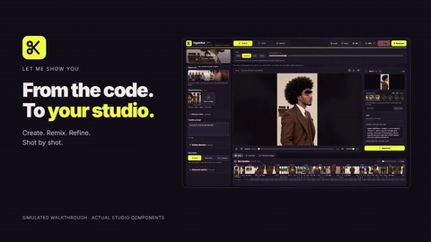
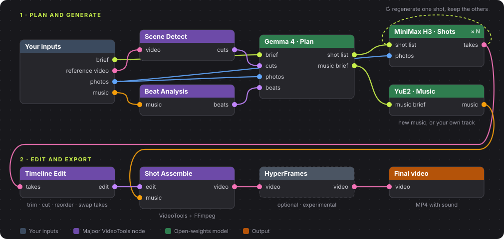
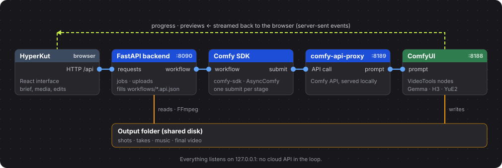

<p align="center"><b>A local AI video studio for edits you can keep directing.</b><br>Remix a reference, start with an idea, or build around your music.</p>

<p align="center"><a href="README.fr.md">Français</a> · <a href="#examples">Examples</a> · <a href="#install-on-windows">Installation</a> · <a href="LICENSES.md">Licenses</a></p>

> **Beta.** Finishing (effects, titles, motion graphics, sound design) is experimental and off by default.

Built with ComfyUI for the [Comfy Open Source Higgsfield challenge](https://comfy.org/open-source-higgsfield). Open-weights models, running on your machine.

## Demo

| Official demo · 1 min 51 | Walkthrough · 1 min 47 |
|:---:|:---:|
| <a href="docs/media/hyperkut-demo-official.mp4"></a> | <a href="docs/media/hyperkut-demo-readme.mp4"></a> |

Silent previews: click one to watch the full video with sound. Everyone shown is AI-generated by the author.

## What it does

| Start with… | Mode | You get… |
|---|---|---|
| A video and your character or product photos | **Remix** | The same edit, reinterpreted with your subject. |
| A short idea | **Text** | A shot plan, generated shots and a soundtrack. |
| Your music and an idea | **Music** | An edit cut on the beats of your track. |

**Brief → plan → generate shots → choose takes → trim → export.**

- **Fix one shot, keep the rest.** Edit a shot's prompt and regenerate only that shot.
- **Edit after generation.** Trim, cut, reorder and swap takes on a timeline.
- **Everything stays local.** Your projects, your models, open MIT code.

| Start a project | Direct each shot | Finish the edit |
|:---:|:---:|:---:|
| [](docs/media/studio-home.jpg) | [](docs/media/studio-project.jpg) | [](docs/media/studio-finishing.jpg) |

## Examples

Real HyperKut exports. Click a preview to watch with sound.

| Fashion · Remix | Lookbook · Remix | Fashion · Music | Sneaker · Music |
|:---:|:---:|:---:|:---:|
| [](docs/media/demos/hyperkut_26c4e181fe36.mp4) | [](docs/media/demos/hyperkut_4eaec061ddbd.mp4) | [](docs/media/demos/hyperkut_ac3723c049d9.mp4) | [](docs/media/demos/hyperkut_f54b09f850b2.mp4) |

| Product · Text | Character · Text | Headphones · Text |
|:---:|:---:|:---:|
| [](docs/media/demos/hyperkut_9e8e85878a3c.mp4) | [](docs/media/demos/hyperkut_e721126225dd.mp4) | [](docs/media/demos/hyperkut_c9cdc7be3b8b.mp4) |

The fashion Remix reference video belongs to [silver.muse](https://higgsfield.ai/@silver.muse). Thank you for the inspiration.

## How it works



Simplified graph above; the ComfyUI API workflows for each mode are in [`workflows/`](workflows). The nodes come from [Majoor VideoTools](https://github.com/MajoorWaldi/ComfyUI-Majoor-VideoTools).

**How the servers talk.** The backend fills a workflow and submits it through the official Comfy SDK. `comfy-api-proxy` serves the Comfy API locally in front of ComfyUI. Progress and previews stream back to the browser; ComfyUI and the Studio share the output folder.



## HyperKut, Katana and Genjutsu

| | HyperKut | Higgsfield Katana | Higgsfield Genjutsu |
|---|---|---|---|
| Idea | Create and refine a multi-shot edit | Rebuild a reference edit with your assets, through Claude | Transform one clip: motion transfer or object swap |
| Runs on | Your PC, local ComfyUI | Higgsfield cloud | Higgsfield cloud |
| You direct | Prompt per shot, takes, timeline | Instructions in Claude | Source clip and settings |
| Code | Open, MIT | Provider-controlled | Provider-controlled |

HyperKut does not reproduce Katana edits exactly or match Genjutsu's targeted preservation. Sources: [Katana](https://higgsfield.ai/blog/higgsfield-katana), [Genjutsu](https://higgsfield.ai/creator-hub/help-center/tools/how-do-i-use-genjutsu), checked 29 October 2026.

## Install on Windows

**You need:** an NVIDIA GPU, [ComfyUI](https://github.com/Comfy-Org/ComfyUI), Python 3.10+, Node.js 22+, and FFmpeg on PATH.

1. In `ComfyUI/custom_nodes`, install [Majoor VideoTools](https://github.com/MajoorWaldi/ComfyUI-Majoor-VideoTools) and `comfyui_controlnet_aux` with ComfyUI's Python.
2. Download the models listed in the [model inventory](https://github.com/MajoorWaldi/ComfyUI-Majoor-VideoTools/blob/main/docs/models-and-downloads.md).
3. Clone this repo inside the VideoTools folder, as `ComfyUI-Majoor-VideoTools/HyperKut Studio`.
4. In PowerShell, from `HyperKut Studio`:

```powershell
python -m venv .venv
.\.venv\Scripts\python.exe -m pip install -r requirements.txt
Push-Location frontend; npm ci; npm run build; Pop-Location
```

5. Start ComfyUI, then run `.\scripts\run_studio.ps1` and open **http://127.0.0.1:8090/**.

Optional finishing, custom ports and details: [full installation](docs/installation.md) · [user guide](docs/usage.md) · [dependencies](docs/dependency-scopes.md).

## License

Code: **MIT**. Models, dependencies and demo media keep their own terms: see [LICENSES.md](LICENSES.md) and [third-party notices](THIRD_PARTY_NOTICES.md). [Known limits](docs/known-issues-and-roadmap.md) · [Roadmap](ROADMAP.md).

HyperKut is independent and not affiliated with Higgsfield.
