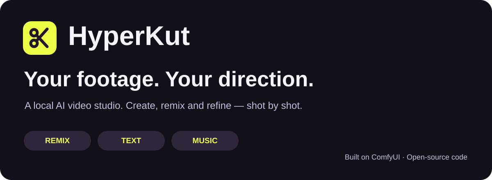

<p align="center"><b>A local AI video studio for edits you can keep directing.</b><br>Remix a reference, start with an idea, or build around your music.</p>

<p align="center"><a href="README.fr.md">Français</a> · <a href="#see-it-in-action">Examples</a> · <a href="#install-on-windows">Installation</a> · <a href="docs/installation.md">Full setup</a> · <a href="LICENSES.md">Licenses</a></p>

> **BETA — The entire HyperKut Studio is currently in beta.** Features and workflows are still evolving. **Finishing is experimental:** internal sub-cuts, visual effects, text/titles, motion graphics, animated design, sound design and sound effects. These optional finishing controls start disabled; review their results before export.

## Official demo

<a href="docs/media/hyperkut-demo-official.mp4"></a>

**1 min 51 · 9:16 · with sound.** [Watch or download the official demo](docs/media/hyperkut-demo-official.mp4). Selected by the project author as the official presentation.

## README demo


[](docs/media/hyperkut-demo-readme.mp4)

**1 min 10 · 16:9 · English narration · with sound.** [Watch or download](docs/media/hyperkut-demo-readme.mp4). This landscape presentation combines a live Studio screenshot, an animated walkthrough made from actual Studio components, and a saved output. The regeneration sequence is illustrative; it does not claim a newly computed take. [Demo provenance and production tools](docs/demo-production.md).

Built for the [Comfy Open Source Higgsfield challenge](https://comfy.org/open-source-higgsfield). 

## Inside the actual app

| 1. Start with your brief | 2. Review and direct each shot | 3. Finish the edit |
|:---:|:---:|:---:|
| [](docs/media/studio-home.jpg) | [](docs/media/studio-project.jpg) | [](docs/media/studio-finishing.jpg) |
| Pick a mode and add your media. | Actual completed 28-shot project, take controls and source-window trim. | Finishing is experimental: internal cuts, effects, typography, graphics and sound. |

These are live interface screenshots, captured 29 October 2026. No generation, regeneration or export was started to produce them. The 28-shot example is a saved edit, not a claim that every shot was generated in this documentation session.

## What does HyperKut do?

**Give it a starting point. Get a multi-shot video. Refine the parts that matter.**

| Start with… | Choose | HyperKut helps you… |
|---|---|---|
| A video and your character or product photos | **Remix** | Reinterpret an edit using its structure and rhythm. |
| A short idea and optional references | **Text** | Turn a brief into a shot plan, generated takes and a soundtrack. |
| A music track and an idea | **Music** | Build an edit guided by measured musical beats and accents. |

**Brief → plan → generate shots → choose takes → trim → export.**

Change a shot's prompt, regenerate that shot, keep another take, or adjust its selected passage. A shared timeline editor supports cutting, reordering and trimming after generation. Finishing tools — internal sub-cuts, visual effects, text/titles, motion graphics, animated design, sound design and sound effects — are **experimental**, optional and **off by default**.

## Why build another video tool?

HyperKut's contribution is the **editable local workflow around generation**:

- **Direct an edit, not just a clip.** Planning, footage, music and finishing belong to one project.
- **Keep the good takes.** Correct one shot without requesting a new generation for every other shot.
- **Separate generation from editing.** Try trims, take selections and finishing without buying another model generation; local rendering still uses compute.
- **Make rhythm a creative choice.** Music analysis guides timing, with room for held actions and quieter passages.
- **Own the workflow code.** Inspect the ComfyUI graphs and prompts, retain local project files and adapt the MIT-licensed application code.

These are design choices, not claims that HyperKut invented video editing or always produces a better result.

## See it in action

Click an image to open its video. Markdown hosts do not consistently support inline video playback; the [local video gallery](docs/demo-gallery.html) provides players with looping controls when opened in a browser.

| Fashion / Remix | Product | Music / product |
|:---:|:---:|:---:|
| [](docs/media/demos/hyperkut_26c4e181fe36.mp4) | [](docs/media/demos/hyperkut_c9cdc7be3b8b.mp4) | [](docs/media/demos/hyperkut_f54b09f850b2.mp4) |

[All supplied examples and file details](docs/demo-media.md). The gallery includes seven `hyperkut_…` exports and the separately labelled supplied `outfit` clip. These are examples, not quality guarantees. **This media package is for private review until publication rights are cleared; the MIT code license does not license the videos or their soundtracks.**

## Credits & thanks

The original fashion video used as the **Remix reference** in our fashion example and Studio demo belongs to **[silver.muse](https://higgsfield.ai/@silver.muse)**, as identified by the project author. Thank you, silver.muse, for the original creation and the inspiration behind this Remix demonstration.

HyperKut generated the demonstrated reinterpretation with our character reference; it did not create the original source video. This credit does not assert a redistribution license or an endorsement by the creator.

## HyperKut, Katana and Genjutsu

Different approaches to related creative tasks:

| | HyperKut | Higgsfield Katana | Higgsfield Genjutsu |
|---|---|---|---|
| Main idea | Create and refine a multi-shot edit in a local studio | Rebuild a reference/preset edit with your assets through Claude and Higgsfield MCP | Transform an existing clip through motion transfer or targeted object swaps |
| Where generation runs | Local ComfyUI and downloaded models | Higgsfield's hosted services | Higgsfield's hosted services |
| Main interaction | Visual projects, shot prompts, retained takes and timeline edits | Reference/preset and follow-up instructions in Claude | Source clip, references and transformation controls |
| What you can adapt here | Application source, workflow graphs, planning prompts and local finishing | Provider-controlled implementation | Provider-controlled implementation |

HyperKut does **not** promise Genjutsu's advertised targeted preservation or exact reproduction of Katana edits. Identity, movement, narrative continuity and musical fit need review. It does not currently provide a validated end-to-end dubbing, speech-subtitle or semantic-highlight workflow.

Comparison based on Higgsfield's [Katana overview](https://higgsfield.ai/blog/higgsfield-katana) and [Genjutsu guide](https://higgsfield.ai/creator-hub/help-center/tools/how-do-i-use-genjutsu), checked 29 October 2026. HyperKut is independent and is not affiliated with Higgsfield.

## How it is built

```text
React Studio — brief, references, shots, takes and timeline
       |
FastAPI backend — project state and staged workflow execution
       |
Official Comfy SDK → comfy-api-proxy → local ComfyUI
       |                               |
       |                    Gemma / H3 / YuE2 + optional branches
       |                               |
       +-------- retained footage and edit plan
                                       |
                     VideoTools / FFmpeg assembly
                     + requested HyperFrames graphics
                     + optional Tone-generated SFX bank
                                       |
                                 final video
```

Generation is organized into planning, per-shot generation and editing stages. The Studio and ComfyUI currently share the media/output disk; remote deployment is not established by changing the SDK URL alone.

**Try a documented case:** [fashion Remix recipe and verification steps](docs/examples/fashion-remix.md). Its recorded seed, settings and input hashes are included. The source video is withheld from redistribution; exact reproduction is therefore not yet a public one-command example. [Measured environment and validation scope](docs/validation-summary.md).

## Install on Windows

**First:** install a recent [ComfyUI](https://github.com/Comfy-Org/ComfyUI) with native support for the configured models. Install [Majoor VideoTools](https://github.com/MajoorWaldi/ComfyUI-Majoor-VideoTools) and `comfyui_controlnet_aux` in `ComfyUI/custom_nodes`, using **ComfyUI's Python environment** for their requirements.

Place the matching Studio source **inside the VideoTools folder**:

```text
ComfyUI/custom_nodes/ComfyUI-Majoor-VideoTools/
├── core/  nodes/  scripts/
└── HyperKut Studio/
    ├── backend/  frontend/  workflows/
    └── README.md
```

Studio source is distributed separately at [HyperKut-Studio](https://github.com/MajoorWaldi/HyperKut-Studio); the matching VideoTools pack is also required. Use a source release containing the backend, frontend and workflow files before continuing.

**1. Download the models.** Follow the [configured model inventory](https://github.com/MajoorWaldi/ComfyUI-Majoor-VideoTools/blob/main/docs/models-and-downloads.md). Download weights separately and accept their applicable terms.

**2. Install the Studio.** Open PowerShell in `HyperKut Studio`:

```powershell
python -m venv .venv
.\.venv\Scripts\python.exe -m pip install -r requirements.txt
Push-Location frontend
npm ci
npm run build
Pop-Location
```

**3. Experimental finishing (optional).** In the **parent VideoTools folder**, install the graphics renderer and/or sound palette if you want those features:

```powershell
powershell -ExecutionPolicy Bypass -File .\scripts\install_hyperframes.ps1
powershell -ExecutionPolicy Bypass -File .\scripts\install_tone.ps1
```

**4. Launch.** Start ComfyUI first. In the Studio folder:

```powershell
.\scripts\run_studio.ps1
```

Open **http://127.0.0.1:8090/**. The helper uses ComfyUI on `8188` and the SDK proxy on `8189`. Keep the server local. For custom ports/output paths and portable preset inputs, see [full installation](docs/installation.md) and [preset setup](docs/portable-presets.md).

## Dependencies, simply

| Component | Needed for |
|---|---|
| Compatible NVIDIA GPU, drivers and ComfyUI/PyTorch | Local model generation; VRAM and speed depend on model precision, offloading, resolution and duration. No universal minimum is qualified here. |
| Studio Python 3.10+ | API server; install `requirements.txt` in its own virtual environment. |
| Node.js **22+** and npm | Building the interface; also running HyperFrames and installing the sound bank. |
| FFmpeg and ffprobe on PATH | Media decoding, assembly, audio and export. |
| Majoor VideoTools + `comfyui_controlnet_aux` | Maintained Studio API workflow nodes. KJNodes/Easy-Use are additional visual-workflow editing dependencies, not requirements of the exported Studio API graphs. |
| Gemma 4 + MiniMax H3 | Vision/planning and video generation in the maintained workflow. |
| YuE2 | Newly generated music; supplied-track workflows have a different music path. |
| FLUX.2 klein / BiRefNet | Optional location generation / subject masks for applicable branches. |
| HyperFrames + GSAP + compatible local browser | Experimental titles, shared graphic layers and animated design. |
| Tone.js + puppeteer-core + Chrome/Edge | One-time generation of the optional, experimental 30-cue sound bank; mixing existing WAV cues does not need a browser per edit. |

Studio Python runtime: `comfy-sdk[pil]`, `comfy-api-proxy`, FastAPI, Uvicorn, python-multipart, HTTPX, Pydantic, filelock and AnyIO. UI: React/React DOM; TypeScript/Vite build tools. VideoTools' own requirements are installed separately into ComfyUI. [Full dependency scope](docs/dependency-scopes.md).

## Beta status and licenses

Original application code is **MIT**. Models, GSAP, other dependencies and media retain their own terms: [license scope](LICENSES.md), [notices](THIRD_PARTY_NOTICES.md). Local inference does not automatically grant model or commercial rights, and does not eliminate download/account requirements. Prepare resources before offline use.

Windows is the documented integration path. A reproducible public fresh-clone GPU installation and cross-platform qualification remain release work. See [readiness](docs/submission-readiness.md), [known limits](docs/known-issues-and-roadmap.md), [roadmap](ROADMAP.md) and the [user guide](docs/usage.md).
